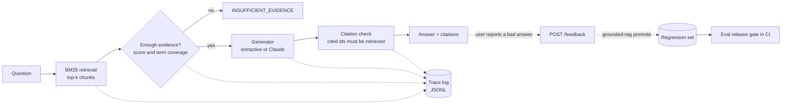

# grounded-rag-eval

A retrieval-augmented question-answering service built around one rule: **an answer that cannot be traced to a source should not be shipped.**

Most RAG demos stop at "it answers questions". This one covers what makes a RAG system safe to put in front of users:

- **Enforced citations.** Every answer must cite the chunks it came from. Citations to chunks that were not retrieved are flagged.
- **Abstention.** When the evidence is weak, the system says so instead of guessing.
- **An evaluation set and a release gate.** A held-out set of 36 questions, including 6 the corpus cannot answer. CI blocks a change if any quality metric drops below the committed baseline.
- **Tracing.** Every request logs a trace: retrieved chunks, scores, abstention reason, latency per stage and token use.
- **A feedback loop.** Users report bad answers through the API. A developer promotes the report into a permanent regression test with one command.

The knowledge base is a set of **synthetic documents** about a fictional estuary water-quality monitoring program, so the repo contains no real or sensitive data.

## Architecture



Two generators share the same interface:

| Generator | What it does | When to use it |
|---|---|---|
| `extractive` (default) | Returns the best-matching source sentences with their citations. Deterministic, no API key. | CI, local development, and as a baseline that any LLM has to beat. |
| `claude` | Sends the retrieved chunks to Claude with grounding rules: answer only from the sources, cite every fact, or reply `INSUFFICIENT_EVIDENCE`. Refusals are treated as abstentions, and a server-side fallback model is enabled. | Production-quality answers. Needs `ANTHROPIC_API_KEY`. |

## Results

Current results for the `extractive` baseline on the 36-question evaluation set (`eval/golden.jsonl`):

| Metric | Value | What it measures |
|---|---|---|
| Retrieval recall@4 | 1.00 | A relevant document is in the top 4 chunks |
| MRR | 0.98 | How high the first relevant chunk ranks |
| Answer accuracy | 0.83 (25/30) | The answer contains every required fact |
| Citation validity | 1.00 | Every answer cites only chunks that were retrieved |
| Correct abstention rate | 0.83 (5/6) | The system declines questions the corpus cannot answer |
| Latency p50 | < 1 ms | Retrieval and generation, excluding the network |

The full report, including every failed case, is in [eval/results/extractive.md](eval/results/extractive.md).

**What the failures show.** Retrieval finds the right document every time. The 5 accuracy misses come from the extractive generator picking the wrong sentence, because keyword matching can't link "start" with "began" or "closure" with "closes". The one abstention miss ("Who is the current program manager?") matches words that appear in the corpus even though the corpus never names the manager. Both are exactly the kind of gap the `claude` generator is there to close, and the evaluation set measures whether it does.

**The gate works.** Making retrieval worse (`top_k=1`) fails the gate on recall, accuracy and fact coverage. Turning off abstention fails it on correct abstention rate.

## Quick start

```bash
python -m venv .venv && source .venv/bin/activate   # Windows: .venv\Scripts\activate
pip install -e ".[dev]"

grounded-rag ask "How often do sondes record a reading?" --trace
grounded-rag eval --gate          # run the evaluation set and compare with the baseline
pytest -q                         # 21 unit and API tests
grounded-rag serve                # API at http://127.0.0.1:8000/docs
```

Using Claude instead of the extractive generator:

```bash
pip install -e ".[claude]"
export ANTHROPIC_API_KEY=...
grounded-rag eval --provider claude --update-baseline   # first run records the Claude baseline
```

The model defaults to `claude-opus-5-5` at low effort, which suits short grounded answers. Override it with `GRAG_CLAUDE_MODEL` and `GRAG_CLAUDE_EFFORT`.

With Docker:

```bash
docker build -t grounded-rag-eval .
docker run -p 8000:8000 grounded-rag-eval
```

## API

| Endpoint | Purpose |
|---|---|
| `POST /ask` `{"question": "..."}` | Returns the answer, `abstained`, the cited chunks with their text, latency and a `trace_id` |
| `POST /feedback` `{"trace_id": "...", "issue": "..."}` | Records a user-reported problem together with the full trace |
| `GET /health` | Liveness check, active generator and index size |

## From user report to regression test

```bash
# 1. A user reports a bad answer through POST /feedback; it lands in logs/feedback.jsonl with its trace.
# 2. A developer confirms the failure and promotes it into the regression set:
grounded-rag promote <trace_id> --unanswerable                       # the right behaviour is to abstain
grounded-rag promote <trace_id> --expected-doc flood_event_2024 --fact "19 days"
# 3. eval/regression.jsonl now runs on every commit. The gate fails until the fix lands.
```

The frozen golden set and the regression set are kept in separate files, so production incidents add coverage without changing the held-out benchmark.

## Design decisions

- **BM25 instead of embeddings.** On a small, terminology-heavy corpus, lexical retrieval reaches perfect recall here, has no model download, and makes CI fast and deterministic. The `BM25Index` sits behind a small interface, so dense or hybrid retrieval can be added and compared on the same evaluation set.
- **Abstain before generating.** The pipeline checks retrieval strength (BM25 score and the IDF-weighted share of query terms found in the best chunk) before calling a model. Off-topic questions never cost tokens, and the generator can still abstain on its own.
- **Citations are checked, not trusted.** Citation ids are parsed from the answer and compared with what was actually retrieved, so a model that invents a source is caught in the trace and in the metrics.
- **Gate on quality metrics, report latency.** Latency depends on the machine, so it is reported but not gated. Quality metrics are gated with a 0.02 tolerance.

## Limitations

- The corpus is small and synthetic. Thresholds were chosen by hand on this evaluation set; a real system would tune them on a separate development split.
- Fact checking uses required substrings, which suits short factual answers but not long-form ones. An LLM-as-judge with expert-scored calibration would be the next step for open-ended questions.
- The trace store is a JSONL file. In production this would go to an observability backend such as OpenTelemetry or CloudWatch.

## Project layout

```
data/corpus/            synthetic knowledge base (12 markdown documents)
eval/golden.jsonl       held-out evaluation set (30 answerable + 6 unanswerable)
eval/baseline.*.json    committed baselines used by the release gate
src/grounded_rag/
  corpus.py             chunking into citable units
  retrieval.py          BM25 index and evidence coverage
  generation.py         extractive and Claude generators
  pipeline.py           retrieve, abstain, generate, validate, trace
  evaluate.py           metrics, release gate, markdown report
  api.py                FastAPI service with feedback endpoint
  cli.py                ask / eval / promote / serve
tests/                  unit, pipeline, generator (stubbed client) and API tests
```

---

Built by [Loc Nguyen](https://www.linkedin.com/in/loc-nguyen-ai/). The same pattern (held-out expert evaluation, release gates and incident-driven regression tests) is how I ran LLM features in production.
